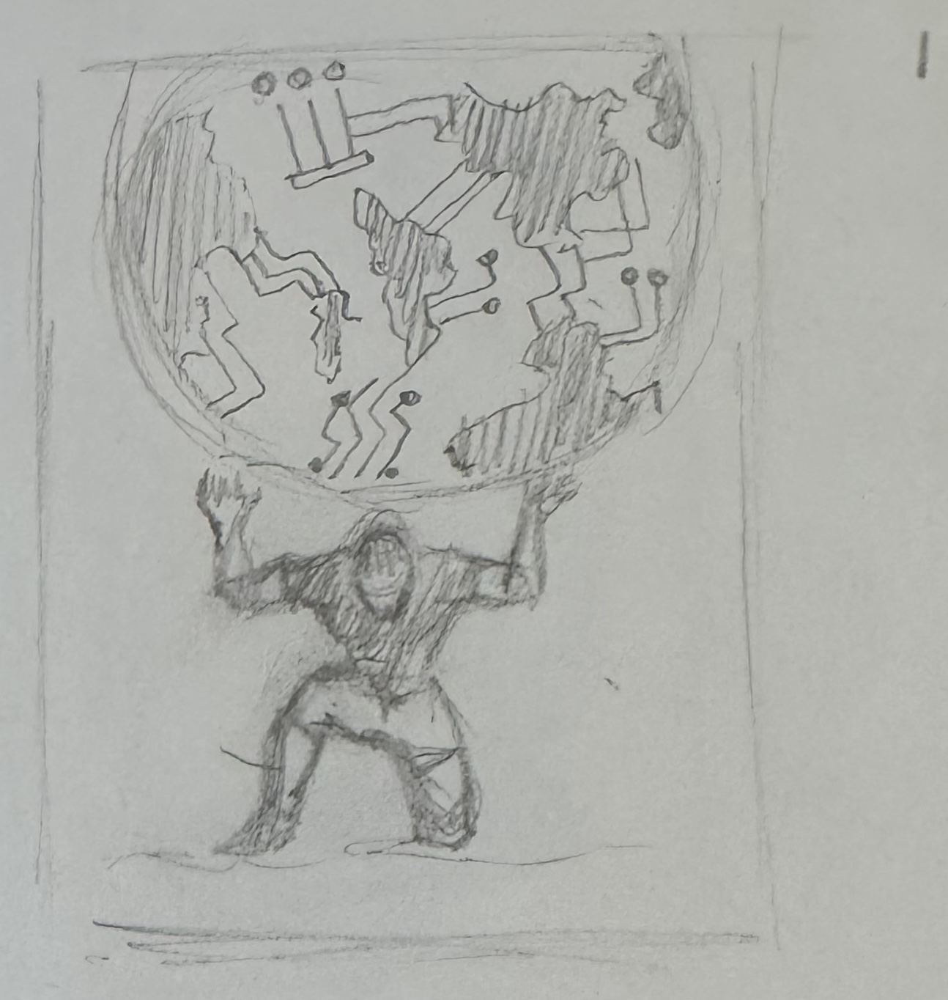
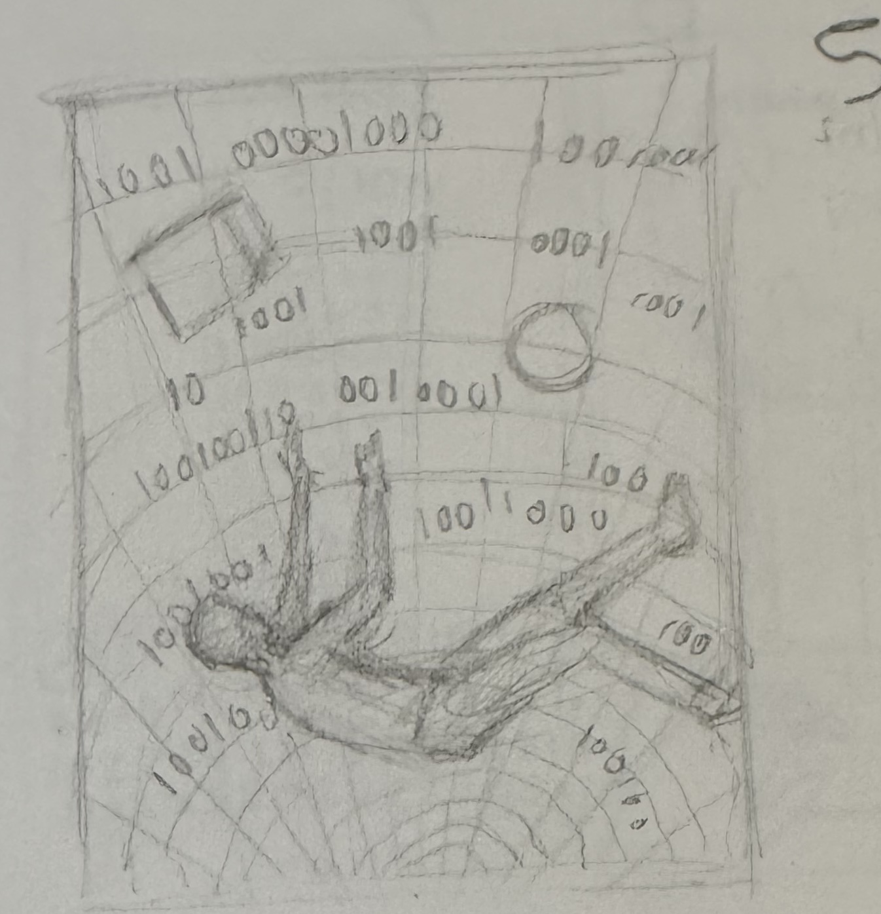
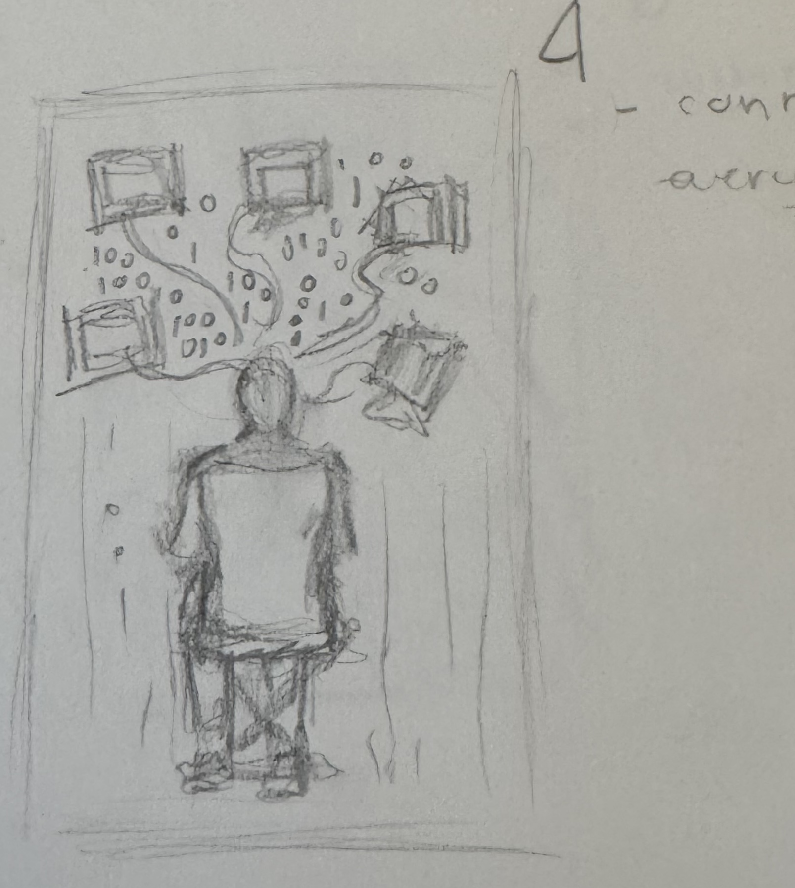
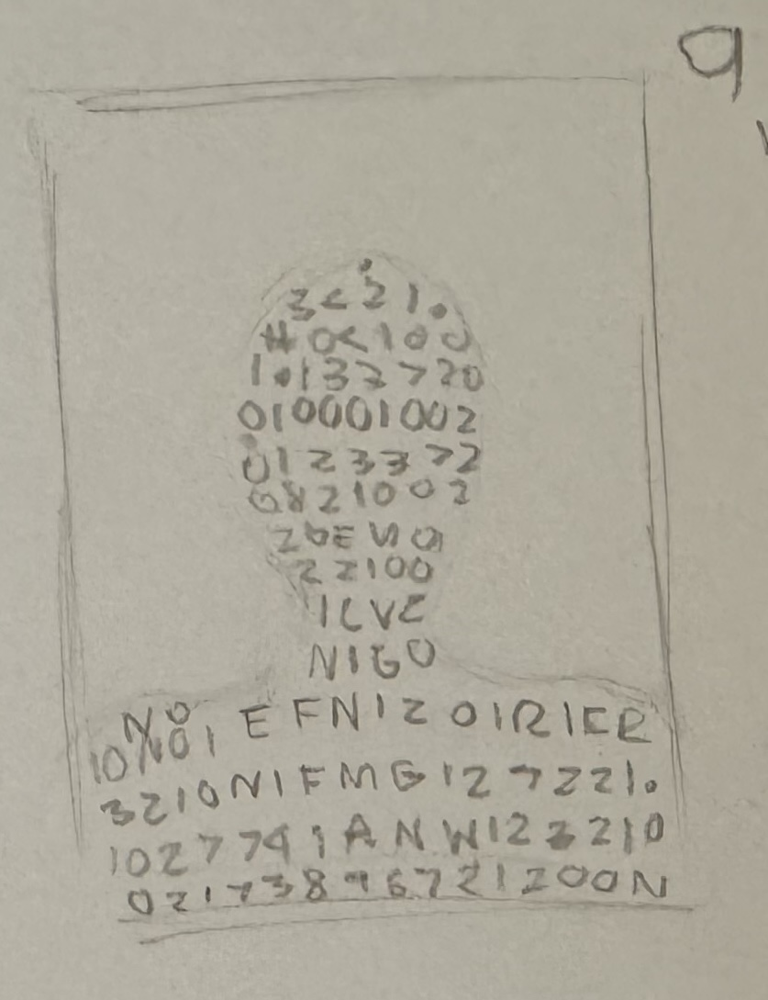

# Test Article 1

> [!NOTE]
> **THIS PAGE IS USED FOR TESTING [GUFFIN](https://github.com/jpanico/guffin) – DO NOT REMOVE**
>
> Features:
>
> - Page is completely self-contained – there are `no Roam embeds` of any kind
> - 3 top-level `headers`, all H1
> - nested `headers` down to H4, via *Augmented Headings* extension
> - a node, (Ma5KGUH9O) “AI assistant (Claude Opus 4.6):” that has property: BLOCK_HEADING = 0, which is not a valid Markdown level. It seems that this can happen when first a valid level value (1-6) is assigned, and then the heading level is removed altogether through the Roam UI.
> - a pair of JPEG `image`s that **have not** been resized through the Roam UI (illustration 1.1)
> - a single JPEG `image` that **has** been resized through the Roam UI (illustration 2.1)
> - a JPEG `image` whose child block renders as its caption, below the image (illustration 2.1)
> - three Python `code block`s (Section 1.2): one with a caption – its child block – and no `code-source::` tag (listing 1.2.1), one with a `code-source::` tag – a SHA-pinned GitHub blob URL, through its `guffin-meta::` child – and no caption (listing 1.2.2), and one with both, the caption set above the source attribution (listing 1.2.3)
> - a `float:: figure` wrapper block (Section 1.3) whose text is the figure’s caption and whose one content child is a JPEG `image` block itself, not a reference to one; it renders as the numbered Figure 1, and the text block before it refers to it with a kind-word alias – an inline `block reference` aliased `figure` – which the export completes with the number and links to the figure
> - a `float:: listing` wrapper block (Section 1.4) whose text is the listing’s caption and whose one content child is a Python `code block` itself, not a reference to one; it renders as the numbered Listing 1, and the text block before it refers to it with the kind-word alias `listing`, completed with the number and linked
> - a `float:: table` wrapper block (Section 1.5) whose text is the table’s caption and whose one content child is a native `{{table}}` (2x3) itself, not a reference to one; it renders as the numbered Table 1, its caption carried by the table itself, and the text block before it refers to it with the kind-word alias `table`, completed with the number and linked
> - a native `{{table}}` (Section 2.2) whose four cells are each a standalone `block reference` to a JPEG `image` block, so each cell displays its referenced image
> - an embedded PDF document that has no special PublishingSemantics Attributes attached
> - an embedded PDF document that has `guffin-meta:: pdf-render: "inline"`
> - this INFO `Callout box`, which contains Roam `page references`

## Section 1

### Section 1.1

#### illustration 1.1

- this image **has not been resized** through the Roam UI.
  


- AI assistant (Claude Opus 4.6):

### Section 1.2

#### listing 1.2.1

- this code block has a caption – its child block – and no `code-source::` tag

``` python
def greet(name: str) -> str:
    return f"Hello, {name}!"
```

A caption authored as the listing’s child block.

#### listing 1.2.2

- this code block has a `code-source::` tag (through its `guffin-meta::` child) and no caption

``` python
"""JSON value typing.

Public symbols:

- :type:`JsonValue` — a JSON-serializable value: a primitive, or lists/objects of nested JSON
  values.
"""

type JsonValue = None | bool | int | float | str | list[JsonValue] | dict[str, JsonValue]
"""A JSON-serializable value: a primitive, or lists/objects of nested JSON values."""
```

#### listing 1.2.3

- this code block has both a caption and a `code-source::` tag; the caption renders above the source attribution

``` python
"""Generic two-dimensional geometry types.

Public symbols:

- :class:`ImageSize` — pixel dimensions (width × height) of a two-dimensional image.
"""

from pydantic import BaseModel, ConfigDict
```

A caption authored as the listing’s child block, set above its source attribution.

### Section 1.3

- the next block is a `float:: figure` wrapper (declared by its `guffin-meta::` child): its text is the figure’s caption, and its one content child is the image block itself, not a reference to one; this sentence refers to it by its kind word – see [figure 1](#float-hJFB2787-) – which the export completes with the figure’s number

<a id="float-hJFB2787-"></a>


***Figure 1.** The flower, as a numbered figure.*

### Section 1.4

- the next block is a `float:: listing` wrapper (declared by its `guffin-meta::` child): its text is the listing’s caption, and its one content child is the code block itself, not a reference to one; this sentence refers to it by its kind word – see [listing 1](#float-FxpYHx75w) – which the export completes with the listing’s number

<a id="float-FxpYHx75w"></a>

``` python
def area(width: float, height: float) -> float:
    return width * height
```

***Listing 1.** A short function, as a numbered listing.*

### Section 1.5

- the next block is a `float:: table` wrapper (declared by its `guffin-meta::` child): its text is the table’s caption, and its one content child is the native `{{table}}` block itself, not a reference to one; this sentence refers to it by its kind word – see [table 1](#float-SHonLC9nH) – which the export completes with the table’s number

<a id="float-SHonLC9nH"></a>

***Table 1.** Polygons and their sides, as a numbered table.*

| Polygon  | Sides |
|----------|-------|
| Triangle | 3     |
| Square   | 4     |

## Section 2

### Section 2.1

#### illustration 2.1

- this image **has been resized** through the Roam UI (width:257, height:None)


A caption authored as the image’s child block.

#### asset 2.1

- an asset is a BLOB stored by Roam in Firebase Storage; usually a file dragged into the Roam UI. The Roam Markdown representation of the asset is just the Firebase Storage URL.

- [Bilhetes_SIM4222567_20260727172245.pkpass](Bilhetes_SIM4222567_20260727172245.pkpass "Bilhetes_SIM4222567_20260727172245.pkpass")

#### Section 2.1.1

##### Section 2.1.1.1

### Section 2.2

|  |  |
|----|----|
|  |  |

## Section 3

### Section 3.1

- the following block contains the canonical w3.org “Dummy” PDF file: https://www.w3.org/WAI/ER/tests/xhtml/testfiles/resources/pdf/dummy.pdf

- [dummy.pdf](dummy.pdf "dummy.pdf")

### Section 3.2

- the following block embeds a PDF with guffin-meta:: pdf-render: “inline”

dummy.pdf
